# Theme previews

Captured from Kitty 0.49.2 with JetBrainsMono Nerd Font Mono at 12 pt,
a solid `#101014` background, opacity 1, and custom shaders disabled.
These are real terminal captures; only outer empty space was cropped.

The animation is shown at its first frame. Username and hostname were
replaced with `demo` and `workstation` in temporary configuration copies.
The shell field was set to `fish` to avoid showing the capture harness.
Other metrics reflect the capture machine. The installed themes were not modified.

These fixed layouts can overlap when hardware names are long, as visible
in `scroll`. Window and content dimensions also affect spacing.

## arcane

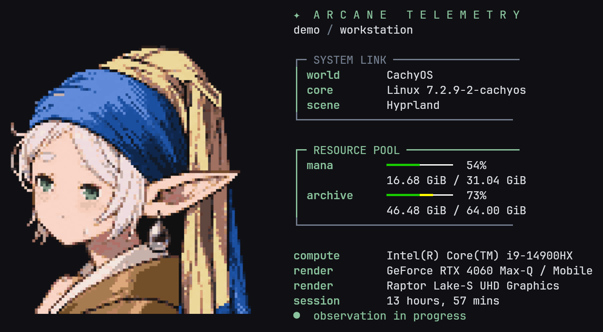

## axis

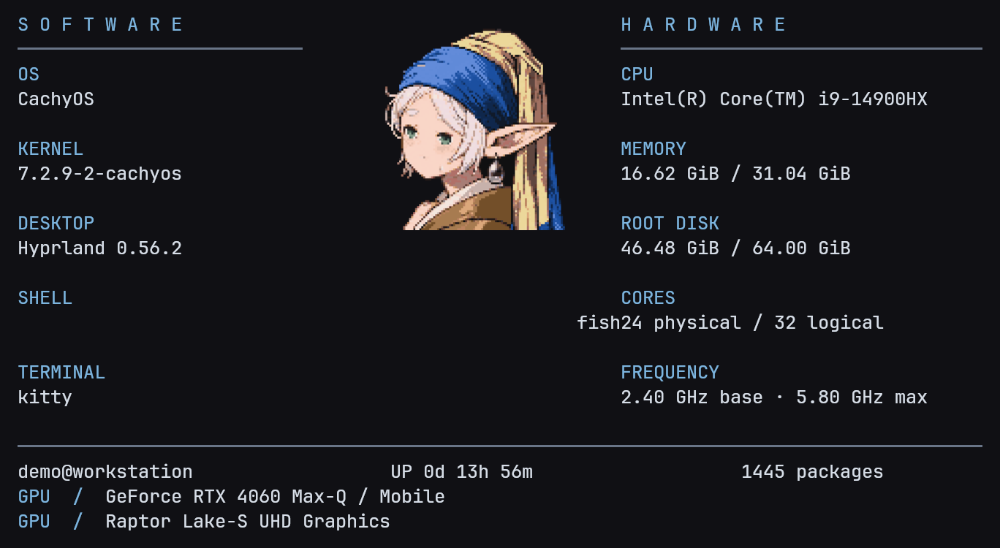

## folio

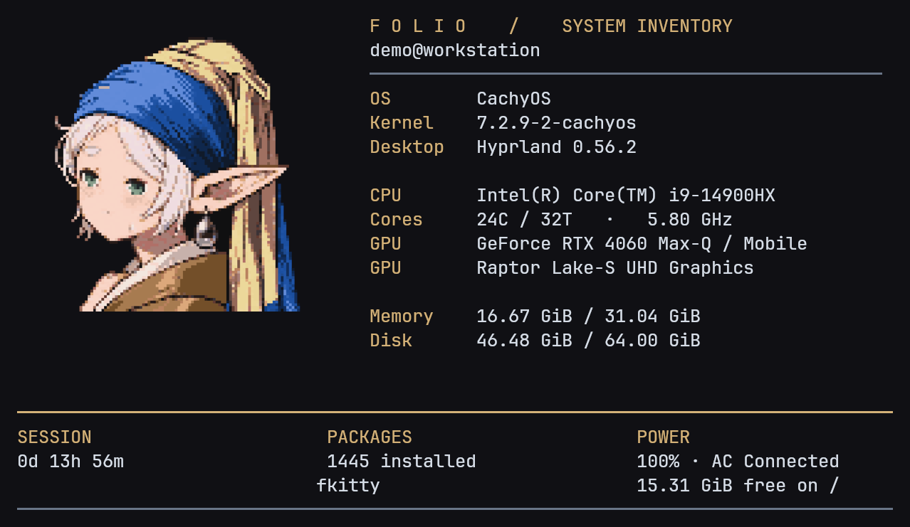

## guild

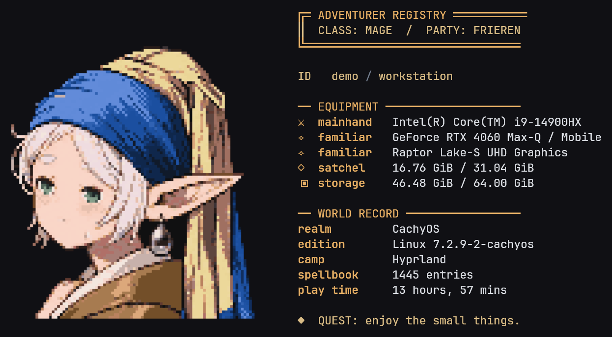

## journey

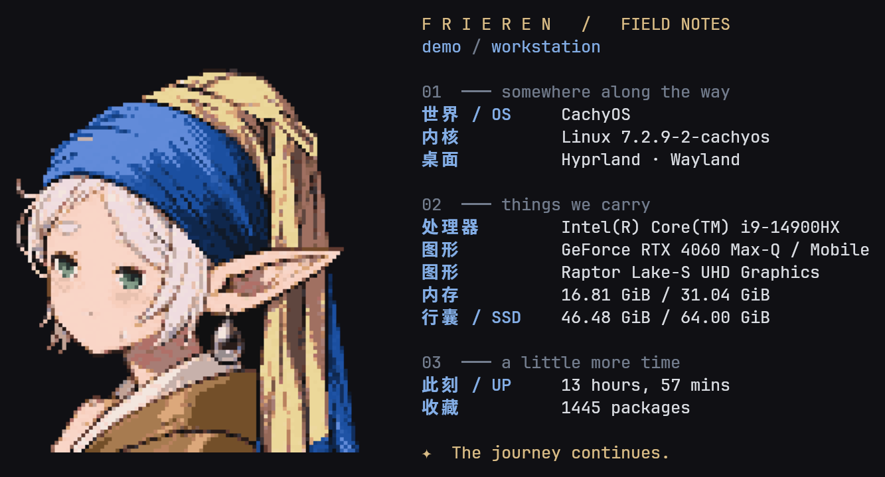

## ledger

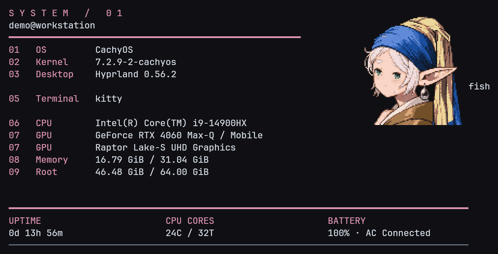

## metro

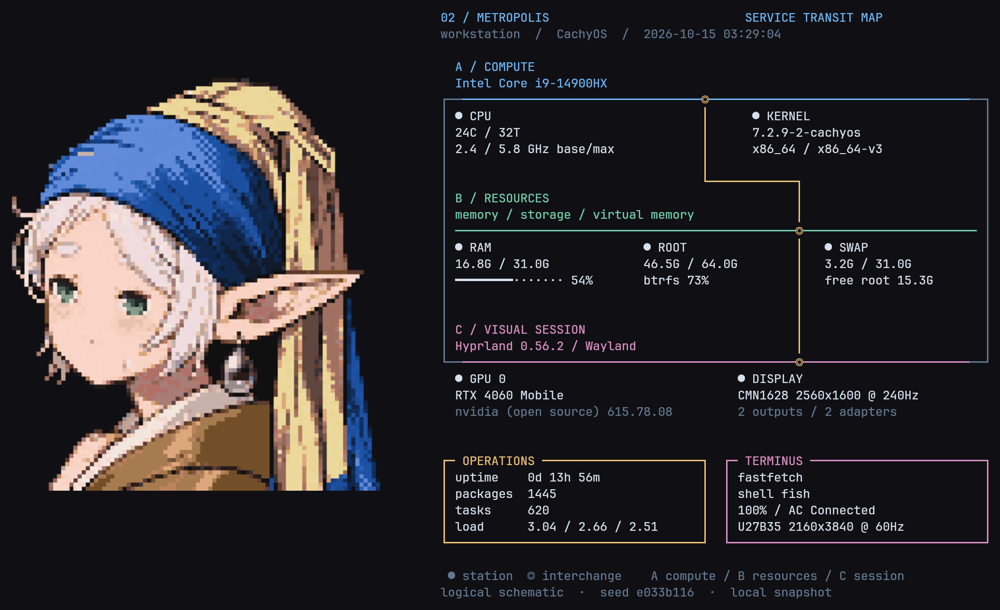

## potion

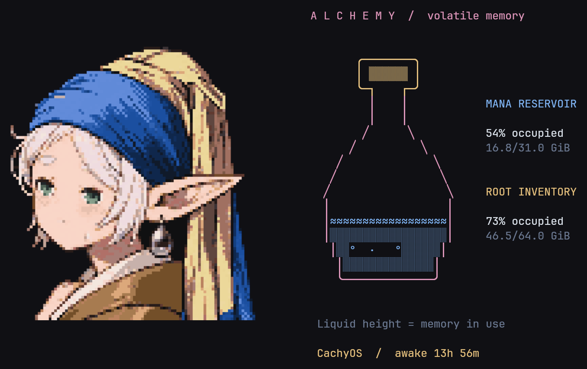

## quiet

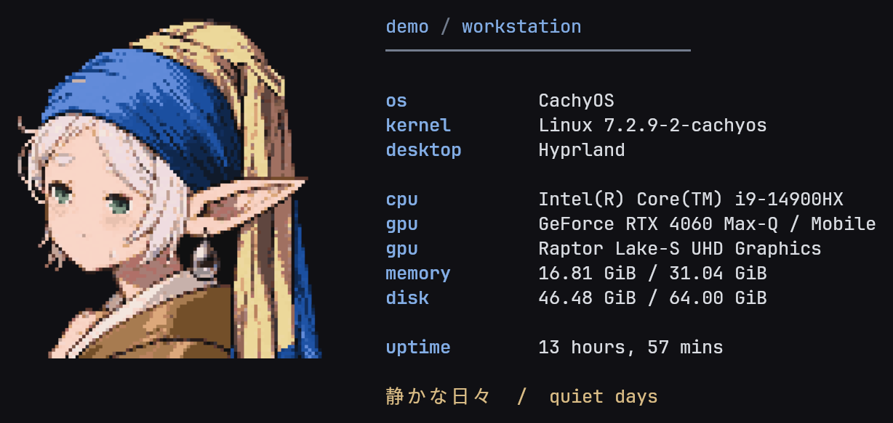

## scroll

## scroll-old

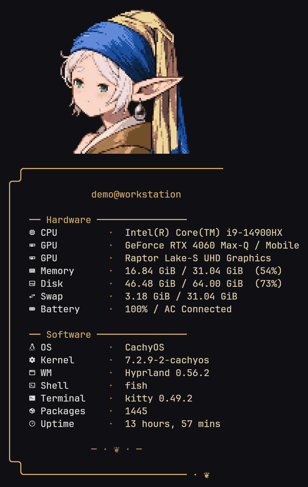

## signal

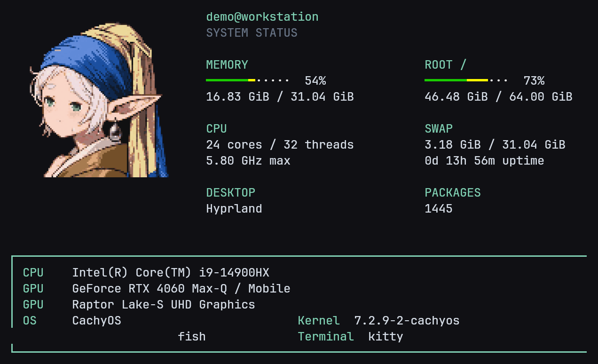

## strata

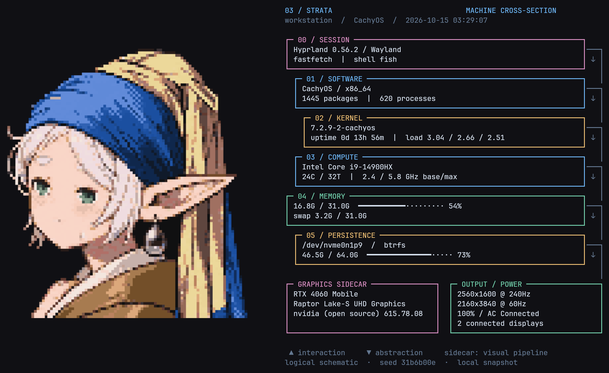
