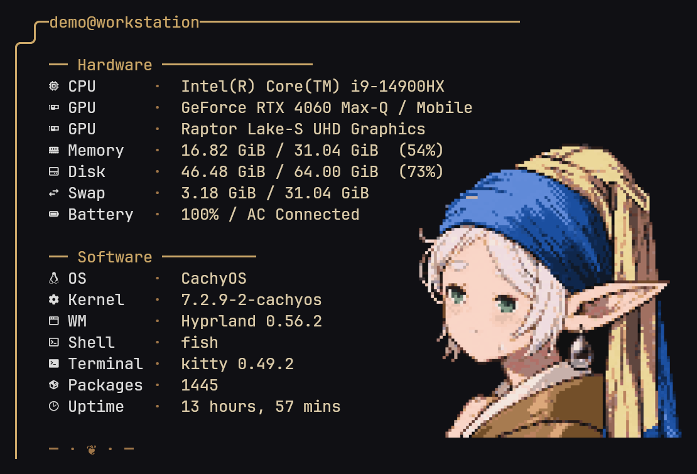

# Fastfetch themes


Reference credit and generation details: [artwork provenance](ARTWORK.md).

Thirteen terminal layouts by zxzx, combining native Fastfetch modules,
procedural system diagrams, and a pixel-art Frieren animation.



[View all 13 theme previews](PREVIEWS.md).

The Scroll layout is used daily in Kitty. Installation, theme switching,
backups, and the Python scenes have been tested with Fastfetch 2.70.0.

## Requirements

- Linux. The Python scenes read Linux `/proc` metrics.
- Fastfetch. The configurations were developed with 2.69.0 and checked with
  2.70.0; older versions have not been verified.
- Bash and standard Unix utilities for `style.sh`.
- Python 3 for `metro`, `strata`, and `potion`; no third-party Python packages.
- A Nerd Font for the module icons.
- Kitty, or a terminal supporting the Kitty graphics protocol, for the image
  logo. Animation support may vary between terminals.

Fastfetch's [logo documentation](https://github.com/fastfetch-cli/fastfetch/wiki/Logo-options)
describes image requirements and `animationFrame: 0`, which enables playback.
On Linux, the `kitty` logo renderer uses ImageMagick support in Fastfetch.

## Installation

Copy `themes/`, `scripts/`, `assets/`, and `style.sh` into
`${XDG_CONFIG_HOME:-$HOME/.config}/fastfetch/`. Back up an existing
`config.jsonc` before selecting a theme. Keep these directories together:
the configurations reference this standard installation location.

```sh
git clone https://github.com/zxzxn3/fastfetch-themes.git
destination="${XDG_CONFIG_HOME:-$HOME/.config}/fastfetch"
mkdir -p "$destination"
cp -r fastfetch-themes/themes fastfetch-themes/scripts fastfetch-themes/assets "$destination/"
cp fastfetch-themes/style.sh "$destination/"
cd "${XDG_CONFIG_HOME:-$HOME/.config}/fastfetch"
bash style.sh list
bash style.sh scroll
bash style.sh use scroll
fastfetch
```

Previewing a theme does not change the default. `use` saves edits to the
current theme before switching; it may therefore update a file in `themes/`.
If the current configuration has no theme marker, it is backed up instead.

```sh
bash style.sh tour       # n/Enter: next; p: previous; r: refresh; s: select; q: quit
bash style.sh save       # save the current configuration back to its theme
bash style.sh status
```

The switcher's prompts and configuration comments are currently in Chinese.
Theme names and command arguments are English.

## Layouts

| Theme | Layout |
| --- | --- |
| `arcane` | Jade magic circuit |
| `axis` | Central image with symmetric information columns |
| `folio` | Image and text above a three-column summary |
| `guild` | Amber adventurer dossier |
| `journey` | Blue-and-gold travel journal |
| `ledger` | Numbered directory with an image in the upper right |
| `metro` | Procedural system transit map |
| `potion` | Procedural potion bottle with a memory-dependent liquid level |
| `quiet` | Minimal layout with generous spacing |
| `scroll` | Warm parchment scroll; current default |
| `scroll-old` | Earlier, narrower scroll variant |
| `signal` | Resource gauges and a horizontal hardware summary |
| `strata` | Procedural layered system diagram |

Layouts use fixed terminal columns and image sizes. Adjust `logo.width`,
`logo.padding`, module formats, and colors for your font and window size.
They are not universally responsive layouts.

The Python renderers gather local system information for display. They do
not upload it. `scripts/logo-fit.py` is an optional sizing helper retained
with the collection; `style.sh` does not invoke it.

## Artwork and attribution

See [ARTWORK.md](ARTWORK.md) for the reference image, its visible artist
credit, and the GPT Astra generation and editing process. The theme author
credit does not replace the reference artist's credit.

No repository-wide license is provided. In particular, the artwork is not
being offered under a blanket open-source license.
